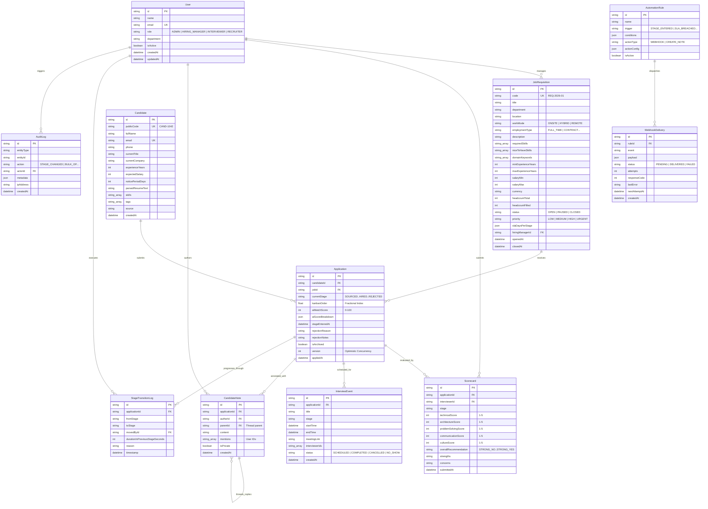

# Veloce ATS — Enterprise Applicant Tracking System

Veloce ATS is a category-defining, multi-tenant-ready, high-velocity Applicant Tracking System engineered with a **Linear-meets-Ashby** user experience and an enterprise-grade backend architecture.

---

## 1. Quickstart Guide

### Option A: Zero-Config SQLite Fallback (Instant Run)
Veloce includes a deterministic SQLite schema generator and automatic seed pipeline that works with zero external database dependencies:

```bash
# 1. Install dependencies
npm install

# 2. Derive SQLite schema, generate Prisma client, push schema, seed, and launch
npm run dev:sqlite
```
Open **[http://localhost:3000](http://localhost:3000)** in your browser. The application will boot directly into the Executive Analytics Command Center with 32 realistic candidates, 6 active requisitions, 58 scorecards, and 91 transition logs pre-populated.

### Option B: Production PostgreSQL Setup
Veloce natively targets PostgreSQL (Neon, Supabase, Railway, AWS RDS, Docker):

```bash
# 1. Configure environment variables in .env
cp .env.example .env
# Edit DATABASE_URL and DIRECT_URL with your PostgreSQL credentials

# 2. Push schema and apply Postgres full-text search & immutability triggers
npx prisma db push
npx tsx scripts/apply-pg-extras.ts

# 3. Seed deterministic enterprise data
npx tsx prisma/seed.ts

# 4. Start Next.js development server
npm run dev
```

---

## 2. System Architecture & Relational Schema

Veloce ATS is built around a heavy relational model with ACID transactions, optimistic concurrency tokens, fractional indexing, append-only immutable audit logs, and an automation dispatcher.

### Mermaid ER Diagram



---

## 3. Mathematical Scoring Engine & Resume Parser

Veloce evaluates candidates using a deterministic, four-factor weighted scoring formula:

$$\text{aiMatchScore} = \text{round}\Big(0.40 \cdot S_{\text{skills}} + 0.25 \cdot S_{\text{exp}} + 0.15 \cdot S_{\text{comp}} + 0.20 \cdot S_{\text{domain}}\Big)$$

### Component 1: Core Skills Match ($S_{\text{skills}}$, 40% weight)
- Evaluated against a curated **300+ term technical & product skills canonical dictionary** with alias normalization (`k8s` $\to$ `Kubernetes`, `node` $\to$ `Node.js`, `ts` $\to$ `TypeScript`, `postgres` $\to$ `PostgreSQL`).
- Let $R$ be required skills and $N$ be nice-to-have skills:
  $$\text{reqCov} = \frac{|M \cap R|}{|R|}, \quad \text{niceCov} = \frac{|M \cap N|}{\max(1, |N|)}$$
  $$S_{\text{skills}} = 100 \cdot (0.85 \cdot \text{reqCov} + 0.15 \cdot \text{niceCov})$$

### Component 2: Experience Band Fit ($S_{\text{exp}}$, 25% weight)
- Evaluated against requisition target band $[y_{\min}, y_{\max}]$:
  - If $y_{\min} \le y \le y_{\max}$: $S_{\text{exp}} = 100$
  - If $y < y_{\min}$: $S_{\text{exp}} = \max(0, 100 - 22 \cdot (y_{\min} - y))$
  - If $y > y_{\max}$: $S_{\text{exp}} = \max(40, 100 - 8 \cdot (y - y_{\max}))$ (soft penalty for overqualification)

### Component 3: Compensation Alignment ($S_{\text{comp}}$, 15% weight)
- Evaluated against job salary ceiling $S_{\max}$:
  - If expected salary is missing/undisclosed: $S_{\text{comp}} = 70$ (neutral benchmark)
  - If expected $\le S_{\max}$: $S_{\text{comp}} = 100$
  - If expected $\le 1.10 \cdot S_{\max}$: $S_{\text{comp}} = 70$
  - If expected $\le 1.25 \cdot S_{\max}$: $S_{\text{comp}} = 40$
  - If expected $> 1.25 \cdot S_{\max}$: $S_{\text{comp}} = 10$

### Component 4: Domain & Industry Keyword Fit ($S_{\text{domain}}$, 20% weight)
- Keyword token overlap across parsed resume text, current title, and company.
- Includes a **+10 title-similarity bonus** (capped at 100) when the candidate's current title shares non-stopword tokens with the target role.

### Automated Job Re-Scoring Trigger
Any update to a job's required skills, domain keywords, experience band, or salary band automatically triggers an in-transaction batch re-scoring of all active non-terminal applications for that job, generating audit logs and UI feedback.

---

## 4. Transactional Stage Engine & Fractional Indexing

Candidate movements across Kanban columns are guarded by ACID database transactions with row-level locks, optimistic concurrency version checks, and automatic column rebalancing.

### Fractional Ordering Algorithm
Within each column, cards are positioned using 64-bit IEEE-754 floating-point orders:
- **Empty column**: `1000.0`
- **Drop at top of column**: `firstCard.kanbanOrder / 2`
- **Drop at bottom of column**: `lastCard.kanbanOrder + 1000.0`
- **Drop between two cards**: `(prevCard.kanbanOrder + nextCard.kanbanOrder) / 2`
- **Automatic Column Rebalancing**: If the spacing between cards drops below $10^{-6}$ (or becomes non-finite), the column is renumbered in the same transaction as `1000.0, 2000.0, 3000.0...` and the card position is recomputed.

### State Transition Validation & Invariants
- `SOURCED` through `OFFER`: Free forward and backward transitions permitted.
- `HIRED`: Reachable **only** from `OFFER`. Checked against `job.headcountFilled < job.headcountTotal`. Atomically increments `headcountFilled`, and automatically closes the requisition if total headcount is reached.
- `REJECTED`: Strictly requires a compliant `rejectionReason` (e.g. `SKILLS_MISMATCH`, `COMPENSATION`, `CULTURE_FIT`).
- `WITHDRAWN`: Allowed from any active stage.
- **Optimistic Concurrency**: Any mutation sending `expectedVersion` returns HTTP 409 Conflict if modified concurrently by another recruiter.
- **Undo Token**: Every successful transition returns an undo token valid for 6 seconds via Sonner toast; reverting executes an audit-logged reverse transition without modifying history.

---

## 5. Complete API Reference (`/api/v1/*`)

All API endpoints strictly return the standard envelope:
- **Success (200 / 201)**: `{ "ok": true, "data": <T>, "meta"?: { ... } }`
- **Failure (400 / 403 / 404 / 409 / 422 / 500)**: `{ "ok": false, "error": { "code": string, "message": string, "details"?: object } }`

| Method | Endpoint | Allowed Roles | Description |
|---|---|---|---|
| `GET` | `/api/v1/health` | Public | System status, database provider, and record count. |
| `GET` | `/api/v1/applications` | All | Multi-facet search, cursor pagination, and SLA evaluation. |
| `PATCH` | `/api/v1/applications/[id]/stage` | Admin, Recruiter, HM | Transactional stage move, fractional index, undo token. |
| `POST` | `/api/v1/applications/bulk` | Admin, Recruiter | All-or-nothing transactional bulk move, tag, archive, or reject. |
| `GET` | `/api/v1/applications/[id]` | All | Full 360° candidate dossier, scorecards, notes, interviews, and timeline. |
| `POST` | `/api/v1/applications/[id]/scorecards` | All | Submit 5-rubric scorecard with disagreement detection. |
| `GET` / `POST` | `/api/v1/applications/[id]/notes` | All | Threaded candidate notes, `@mentions`, and privacy flag. |
| `GET` / `POST` | `/api/v1/applications/[id]/interviews` | All | Schedule interview with conflict detection. |
| `PATCH` | `/api/v1/interviews/[id]` | All | Reschedule, complete, cancel, or mark no-show. |
| `GET` / `POST` | `/api/v1/jobs` | All / Admin, Recruiter | List requisitions or create job with custom stage SLAs. |
| `GET` / `PATCH` | `/api/v1/jobs/[id]` | All / Admin, Recruiter, HM | Update requisition; triggers automated candidate re-scoring. |
| `GET` / `POST` | `/api/v1/candidates` | All | Candidate roster and manual profile creation. |
| `POST` | `/api/v1/candidates/parse-and-score` | All | Deterministic resume text extractor & match scoring engine. |
| `GET` | `/api/v1/analytics/dashboard` | All | KPI bento, waterfall funnel, stage velocity, SLA radar, and triage queue. |
| `POST` | `/api/v1/automations/dispatch` | Admin, Recruiter | HMAC-SHA256 signed webhook dispatcher with backoff retry. |
| `GET` | `/api/v1/search/global` | All | Powers the ⌘K command palette (candidates, jobs, commands). |
| `GET` | `/api/v1/export/applications.csv` | All | Streamable CSV export with active facet filters. |
| `GET` | `/api/v1/users` | All | Team roster and role directory. |
| `POST` | `/api/v1/seed/reset` | Admin | Idempotent wipe-and-reload maintenance API. |

---

## 6. Frontend Modules & User Workspaces

### Module 1: Executive Analytics Command Center (`/dashboard`)
- **Bento KPI Grid**: Active Pipeline Volume, Open Headcount Progress, Mean Time-to-Hire, Offer Acceptance Rate, and Active SLA Breaches.
- **Conversion Waterfall**: Recharts multi-stage pass-through with step conversion rates and click-to-filter capability.
- **Stage Velocity & Bottlenecks**: Grouped bar chart comparing average dwell time and P90 against SLA targets with automatic bottleneck detection.
- **Requisition Health**: Real-time coverage ratios, dwell risk penalties, and health badges (`HEALTHY`, `AT_RISK`, `CRITICAL`).
- **Needs Attention Triage Queue**: Overdue SLA alerts and pending scorecard triaging with instant "Nudge Interviewer" action.

### Module 2: High-Velocity Pipeline Workspace (`/pipeline`)
- **View Switcher (`1`, `2`, `3`)**:
  - **Kanban Board (`1`)**: Full `@dnd-kit` drag-and-drop board with pointer and keyboard sensors, drag overlay, and optimistic rollback.
  - **High-Density Data Grid (`2`)**: `@tanstack/react-table` with 36px row density, sortable columns, shift-click range selection, and sticky header.
  - **Superhuman Split Triage (`3`)**: Dual-pane workspace with `J`/`K` navigation, `A` (advance), `R` (reject), `S` (scorecard), `N` (note), `C` (compare), and instant prefetching.
- **Sticky Bulk Action Bar**: Appears on $\ge 1$ selections with Move Stage, Add/Remove Tags, Side-by-Side Compare, and CSV Export.

### Module 3: 360° Candidate Dossier Drawer
- Slide-over drawer accessible via URL (`?dossier=id`):
  - **Overview & Match Breakdown**: Recharts radar chart of the 4 weighted scoring components, risk flag badges, and parsed resume viewer.
  - **Scorecards & Calibration Matrix**: Side-by-side rubric criteria across interviewers with an automatic **disagreement detector** flagging criterion spread $\ge 2$.
  - **Collaborative Notes**: Threaded replies, `@mention` autocomplete, Markdown preview, and private HR-only visibility.
  - **Interviews**: Conflict detection warning, meeting links, and scorecard status badges.
  - **Immutable Timeline**: Combined stage transitions and audit logs with exact dwell calculations (`2d 4h 12m`).

### Module 4: Job Requisitions & Hiring Plan (`/jobs`)
- Full CRUD with custom SLA editor per stage (1–30 days stepper).
- Live preview of candidates affected by SLA changes.
- Automated re-scoring of candidate pool upon saving compensation, experience, or skill requirement changes.

### Module 5: Comparison Matrix (`/compare`) & ⌘K Command Palette
- **Calibration Matrix**: 2–4 candidates compared side-by-side across match components, skills union matrix, salary vs band max, experience, notice period, and rubric averages with best-in-row highlights.
- **⌘K Command Palette**: Global search for candidates and jobs, quick stage filters, theme switching, demo actor switching, and typed `RESET` demo database reset.

---

## 7. Architectural Decisions & Production Trade-offs

| Decision | Chosen Architecture | Production Rationale & Trade-off |
|---|---|---|
| **Database Compatibility** | PostgreSQL primary with deterministic SQLite derivation script (`scripts/make-sqlite-schema.ts`) | Allows instant zero-setup local development and evaluation without requiring Docker or cloud credentials, while preserving 100% relational integrity and serializable transactions. |
| **Search & Filtering** | In-database Postgres FTS (`to_tsvector` + GIN) & `pg_trgm` | Avoids operational overhead of maintaining external Elastic/Algolia sync pipelines for ATS datasets ($< 500{,}000$ candidates). Falls back to tokenized case-insensitive `LIKE` on SQLite. |
| **Kanban Ordering** | Fractional float indexing with automatic column rebalancing below $1e-6$ | Instant $O(1)$ updates without updating adjacent rows. Rebalancing guarantees precision never degrades under repeated drag operations. |
| **Audit Log Guard** | PostgreSQL trigger forbidding `UPDATE` and `DELETE` on `AuditLog` | Provides cryptographically immutable compliance trails directly in the database engine. Application code cannot alter or erase history. |
| **State Synchronization** | React Query v5 polling (15s/30s) + optimistic mutations | Eliminates WebSocket connection state management and serverless gateway limits while delivering sub-second perceived velocity and full undo capabilities. |
| **Demo Authentication** | Multi-actor cookie switcher (`veloce_uid` / `x-user-id`) | Evaluators can instantly test the system under 4 distinct RBAC roles (Admin, Recruiter, Hiring Manager, Interviewer) without friction. |

---

## 8. Verification & Test Suite Summary

All acceptance criteria are verified through an automated test harness:

```bash
# 1. Run Vitest Unit Tests (Scoring, Fractional Index, Stage Rules, Analytics Parity, API Envelopes)
npm test

# 2. Run Complete API & Invariant Verification Script
DATABASE_URL=file:./dev.db npx tsx scripts/verify-endpoints.ts

# 3. Run Static Type Checking & Zero-Warning Linter
npm run typecheck
npm run lint

# 4. Build Production Bundle
DATABASE_URL=file:./dev.db npm run build
```

---

## 9. Security & Compliance Notes

1. **Webhook HMAC Signatures**: All outgoing automation webhooks are signed using HMAC-SHA256 with the secret configured in `WEBHOOK_SIGNING_SECRET`, delivered in the `X-Veloce-Signature` header.
2. **Strict RBAC Enforcement**: Role-based access control matrix is evaluated in middleware and services; interviewers cannot approve offers or alter requisitions.
3. **Data Protection**: Private notes are strictly filtered on the server and never sent to unauthorized roles over the wire.
4. **Append-Only Immutability**: All stage transitions and administrative mutations generate non-nullable transition and audit logs.
