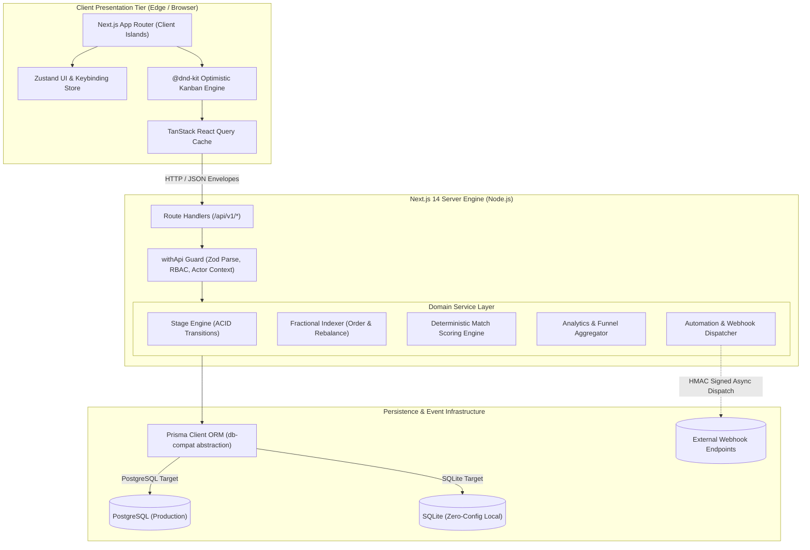
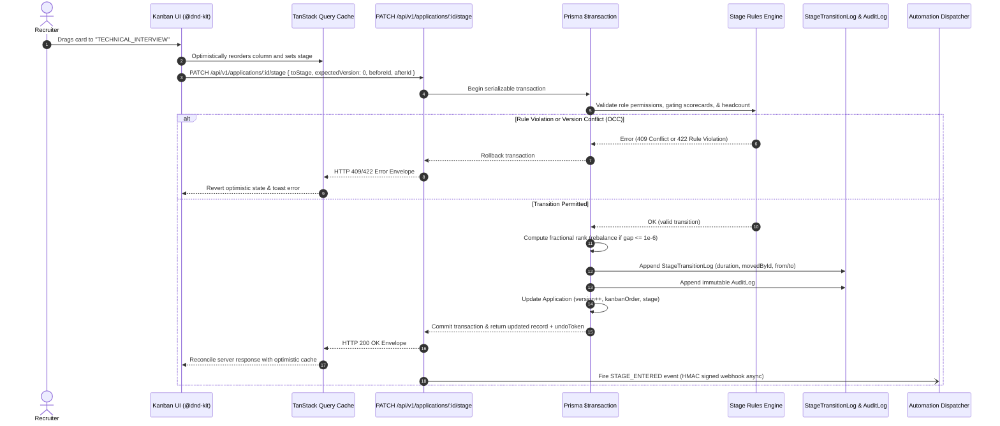

# Veloce ATS: System Architecture

Veloce ATS is engineered as an enterprise-grade applicant tracking platform prioritizing execution velocity, transactional integrity, and low cognitive overhead.

---

## 1. System Topology & Boundaries

---

## 2. Layering & Architectural Boundaries

To preserve maintainability and eliminate circular dependencies, Veloce ATS enforces strict architectural boundaries:

1. **Presentation Components (`src/components/*`)**:
   - Pure UI or client-interactive islands (`use client`).
   - May consume TanStack Query hooks, Zustand store, and Tailwind classes.
   - **Never** import Prisma client, server filesystem, or secrets.
2. **Route Handlers (`src/app/api/v1/*`)**:
   - HTTP transport adapter layer.
   - Wrapped with `withApi()` for declarative schema parsing (`zod`), actor resolution (`getActor`), and standardized envelopes (`ApiResponse<T>`).
   - Delegate all mutations and aggregations directly to domain services.
3. **Domain Services (`src/lib/services/*`)**:
   - Encapsulate business invariants (stage progression rules, fractional rank calculation, audit logging).
   - Responsible for transaction boundaries (`prisma.$transaction`).
   - Decoupled from HTTP requests and response structures.
4. **Data Access & Compatibility Layer (`src/lib/db.ts`, `src/lib/db-compat.ts`)**:
   - Transparently normalizes differences between PostgreSQL (native JSON/arrays) and SQLite (serialized text strings).
   - Guarantees parity across development and production environments.

---

## 3. Transactional Kanban Drop Lifecycle

When a recruiter drags a candidate card between stages on the Kanban board:

---

## 4. Concurrency & Locking Strategy

- **Optimistic Concurrency Control (OCC)**:
  Every `Application` row contains an integer `version` field. When a mutation request is submitted, clients pass `expectedVersion`. If another recruiter or background sync updated the application in the interim (`version !== expectedVersion`), the transaction immediately aborts with `HTTP 409 Conflict`.
- **Database Serialization**:
  On SQLite, write transactions are serialized at the file lock level. On PostgreSQL, `prisma.$transaction` executes with isolation to guarantee that headcount decrements and job auto-closures are race-condition free.
